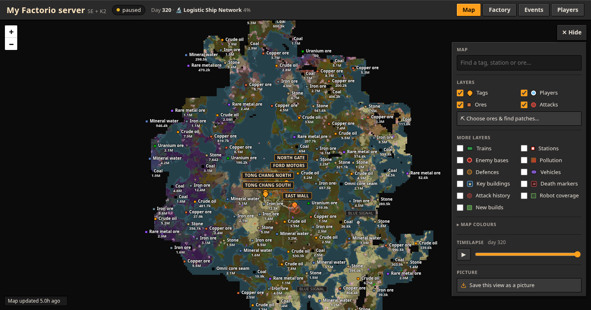
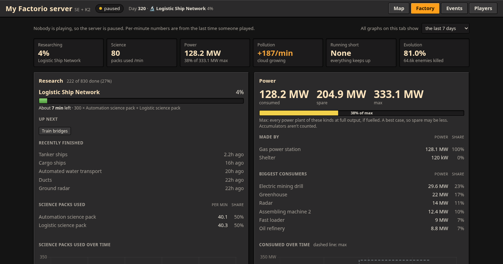
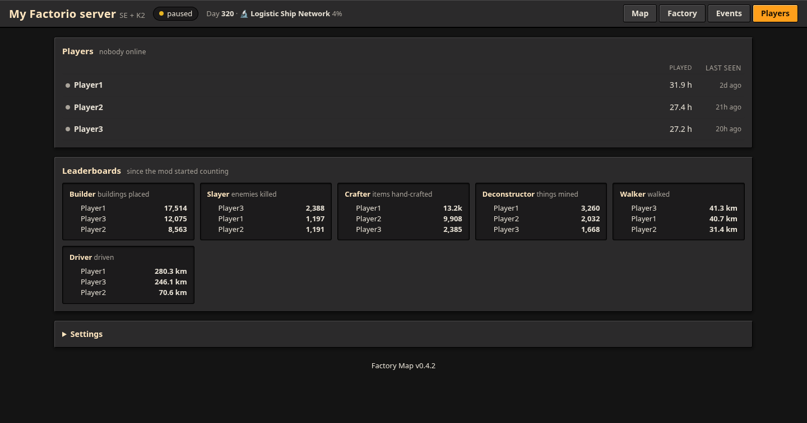

# Factory Map

**A live website for your Factorio server:** zoomable map of the whole factory, timelapse, production, power and research graphs, an event log (chat, deaths, attacks, research) and player leaderboards. Works on phones.

| Part | What it does |
|---|---|
| **The mod** (`mod/factory-map`) | Writes map, stats and events to `script-output/factory-map/`. No gameplay changes. |
| **The website** (`web/`) | A small Python server that reads those files and serves the site. Read-only. |

<table>
<tr>
<td></td>
<td></td>
</tr>
<tr>
<td></td>
<td></td>
</tr>
</table>

## Compatibility

- **Factorio 2.1.** Tested with **Space Exploration + Krastorio 2** (150+ mods, 13,000+ chunks).
- Vanilla and Space Age are untested but should work (standard API only; the site knows Space Age planets and platforms).
- Website: Windows, macOS or Linux with Python 3.10+. Tested on fresh Ubuntu 24.04, Debian 12 and Fedora 41; Windows and macOS not yet tested by a person.
- **Lightweight.** In game it only re-reads the spots where something changed (well under 1 ms) plus a slow background pass, so UPS isn't affected: the 150-mod test save stays at 60 UPS. The website needs about 400 MB of RAM for a big map and a few seconds of CPU per minute while the factory changes, so any PC or small home server can run it.

## Quick start (5 minutes)

1. **Install the mod.** In Factorio: *Mods → Install → search "Factory Map"*. Your friends get it automatically with *Sync mods with server* when they join.
2. **Get the website.** On this page: green **Code** button → **Download ZIP**, then unzip it anywhere (e.g. your Desktop).
3. **Install Python** if you don't have it: [python.org/downloads](https://www.python.org/downloads/) (Windows and macOS). Linux usually has it already.
4. **Start it** by double-clicking:
   - **Windows:** `start-windows.bat`
   - **macOS:** `start-mac.command` (the first time: right-click → *Open* → *Open*)
   - **Linux:** run `./start-mac-linux.sh` in a terminal

   The first start sets things up (about a minute). Then your browser opens **http://127.0.0.1:8480**. Keep the window open; closing it stops the website.
5. **Play.** Host the game with *Multiplayer → Host* (you can host just for yourself; singleplayer doesn't write any data), or start your server. The map appears after the mod has read the whole map once: a few minutes on a big map.

The website finds the Factorio folders by itself (Steam or standalone). Everything is read-only: nothing on the site can change your game.

## Show it to others

| Who | How |
|---|---|
| **People on your Wi-Fi** | In `web/site.json` set `"bind": "0.0.0.0"`, start again, and click *Allow* if the firewall asks. The window shows the address to open, like `http://192.168.1.20:8480`. |
| **Friends anywhere, easiest** (no router settings) | Install [cloudflared](https://developers.cloudflare.com/cloudflare-one/connections/connect-networks/downloads/) (Windows: `winget install Cloudflare.cloudflared`, macOS: `brew install cloudflared`), then run `cloudflared tunnel --url http://localhost:8480` while the website runs. It prints an `https://….trycloudflare.com` link to share. The link changes every time you start it. |
| **Friends anywhere, fixed address** (port forwarding) | Set `"bind": "0.0.0.0"`. In your router, forward **TCP 8480** to this PC's local address (shown in the window). Share `http://<your public IP>:8480` (find it at [whatismyip.com](https://whatismyip.com)). A free name from [DuckDNS](https://www.duckdns.org) keeps working when your IP changes. Plain HTTP, but the site is read-only. |
| **Always-on server** | Run it as a service next to your Factorio server and put nginx with HTTPS in front: [`web/examples/`](web/examples/) has a systemd service and an nginx config. |

The website port (8480) is separate from the game: players still join on UDP 34197. Anyone who can open the site sees player names, chat and positions; chat and positions can be turned off in the mod settings.

## Dedicated and headless servers

Run the website on the machine that hosts the game, the same way (`./start-mac-linux.sh`, or the systemd service). If it doesn't find the server's folder by itself, set `"factorio_data"` in `web/site.json` to the folder that contains `mods/` and `script-output/`:

| Server | `factorio_data` |
|---|---|
| Headless `.tar.xz` | the extracted folder, e.g. `/opt/factorio` |
| Docker ([factoriotools](https://hub.docker.com/r/factoriotools/factorio)) | the host folder mounted at `/factorio` |
| Rented server, website at home | a local copy of its `script-output/factory-map/` and `mods/`, kept in sync (e.g. `rsync` in a loop) |

For English item names on a headless server, set `"factorio_install"` to the game folder (Docker: `docker cp <container>:/opt/factorio/data ./factorio-data`, then point it there).

## Settings

`web/site.json` (environment variables with the same meaning win):

| Key | Default | What |
|---|---|---|
| `server_name` | `Factorio server` | Name in the header and tab title |
| `tagline` | empty | Small text after the name, e.g. your modpack |
| `bind` | `127.0.0.1` | `0.0.0.0` lets other devices open it (`WEB_BIND`) |
| `port` | `8480` | Website port (`WEB_PORT`) |
| `factorio_data` | found automatically | Folder with `mods/` and `script-output/` (`FACTORIO_DATA`) |
| `factorio_install` | found automatically | Game install folder, for English names (`FACTORIO_INSTALL`) |
| `copyright`, `source_url` | empty | Footer text and a source link |
| `timelapse_frame_hours` | `1` | One timelapse frame per this many game hours |

In game, *Settings → Mod settings → Map* (admins, changeable while playing): background re-check interval (30 min), chunks per tick for the first read (1), and switches for chat, player positions and enemy attacks. Commands: `/map-status` (anyone), and for admins `/map-refresh` (re-read the whole map), `/map-export` (write files now), `/map-bench` (time the export on your save).

## Common problems

| What you see | Fix |
|---|---|
| "Python is not installed" | Install it from [python.org/downloads](https://www.python.org/downloads/), then start again. |
| Windows: "Windows protected your PC" | Click *More info* → *Run anyway*. |
| macOS: "can't be opened because it is from an unidentified developer" | Right-click `start-mac.command` → *Open* → *Open*. Only needed the first time. |
| Linux: "Couldn't create the Python environment" | `sudo apt install python3-venv` (Ubuntu/Debian), then start again. |
| "Setup failed" | Usually no internet during the first start (it downloads two Python packages). Check your connection and start again. |
| "Can't use port 8480" | The website is already running in another window, or another program uses 8480: set `"port"` in `web/site.json`. |
| The site opens but says there's no map | Normal until someone plays: the mod only writes while a game is hosted or a server runs, not in singleplayer. Check the mod is enabled. The first full read takes a few minutes (`/map-status` shows progress). |
| "No map data yet … Wrong folder?" in the window | The website looks in the wrong place: set `"factorio_data"` (see above). |
| Item names like `assembling-machine-2` | Set `"factorio_install"` to your Factorio folder, then start again. |
| Map stops changing | The game is paused (servers pause when empty). It continues when someone plays. |
| Friends can't open it | Check `"bind": "0.0.0.0"`, the firewall and the port forward, and test from a phone on mobile data, not your Wi-Fi. If your internet provider doesn't give you a public IP, port forwarding can't work: use the cloudflared link. |
| "Mod mismatch" when joining | Use *Sync mods with server* in the multiplayer menu. |

Advanced: `web/requirements.txt` lists the Python packages if you set things up yourself; `build.sh` builds the mod zip from `mod/factory-map`.

Third-party code is listed in [THIRD_PARTY.md](THIRD_PARTY.md).
