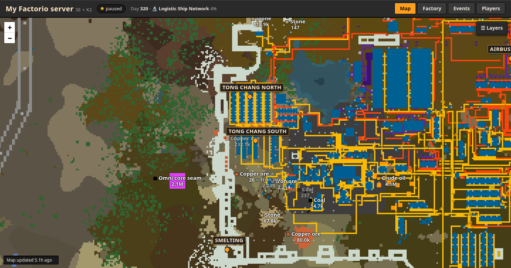
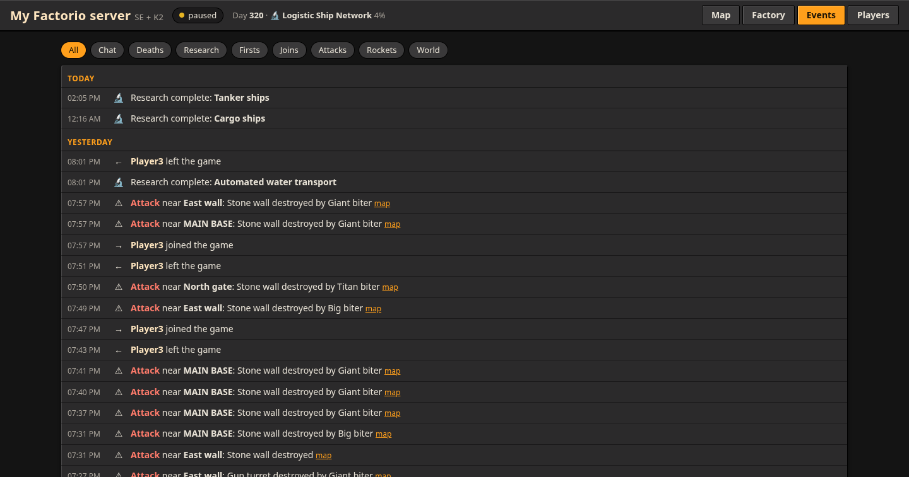
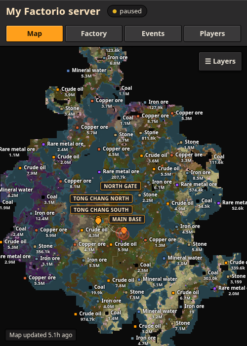

# Factory Map

**A live website for your Factorio server:** zoomable map of the whole factory, timelapse, production, power and research graphs, an event log (chat, deaths, attacks, research) and player leaderboards. Works on phones.

| Part | What it does |
|---|---|
| **The mod** (`mod/factory-map`) | Writes map, stats and events to `script-output/factory-map/`. No gameplay changes. |
| **The website** (`web/`) | A small Python server that reads those files and serves the site. Read-only. |


<table>
<tr>
<td></td>
<td></td>
</tr>
<tr>
<td></td>
<td></td>
</tr>
</table>



## Compatibility

- **Factorio 2.1.** Tested with **Space Exploration + Krastorio 2** (150+ mods, 13,000+ chunks).
- Vanilla and Space Age are untested but should work (standard API only; the site knows Space Age planets and platforms).
- Website: Python 3.10+ on Linux, Windows or macOS.
- **Lightweight.** In game it only re-reads the spots where something changed (well under 1 ms) plus a slow background pass, so UPS isn't affected: the 150-mod test save stays at 60 UPS. The website needs about 400 MB of RAM for a big map and a few seconds of CPU per minute while the factory changes, so any PC or small home server can run it.

## 1. Install the mod (server and every player)

Every player needs the same mod version as the server. Get **Factory Map** from the in-game mod manager (players can use *Sync mods with server*), or by hand: run `./build.sh` (Linux/macOS) and put `dist/factory-map_<version>.zip` in the `mods` folder of the user data folder below. Without bash, copy the `mod/factory-map` folder into `mods` instead.

The mod only writes files on the machine that hosts the game, and **not in singleplayer**: use *Multiplayer → Host* (you can host just for yourself).

## 2. Run the website on the hosting machine

Folders you need:

| | User data folder (`FACTORIO_DATA`: has `mods/`, `script-output/`) | Install folder (for item names) |
|---|---|---|
| **Windows** | `%APPDATA%\Factorio` | Steam: `C:\Program Files (x86)\Steam\steamapps\common\Factorio`, standalone: `C:\Program Files\Factorio` |
| **macOS** | `~/Library/Application Support/factorio` | Steam: `~/Library/Application Support/Steam/steamapps/common/Factorio/factorio.app`, standalone: `/Applications/factorio.app` |
| **Linux** | `~/.factorio` | Steam: `~/.steam/steam/steamapps/common/Factorio` |
| **Headless / .zip / .tar.xz** | the extracted folder, e.g. `/opt/factorio` | the same folder |
| **Docker** ([factoriotools](https://hub.docker.com/r/factoriotools/factorio)) | the host folder mounted at `/factorio` | `docker cp <container>:/opt/factorio/data ./factorio-data` |

**Windows** (PowerShell; Python from python.org):

```powershell
git clone https://github.com/veekaste/factory-map.git
cd factory-map\web
py -m venv .venv
.venv\Scripts\python -m pip install -r requirements.txt
copy site.example.json site.json
.venv\Scripts\python ..\tools\copy_locale.py "C:\Program Files (x86)\Steam\steamapps\common\Factorio"
$env:FACTORIO_DATA="$env:APPDATA\Factorio"; .venv\Scripts\python server.py
```

In cmd.exe the last line is `set FACTORIO_DATA=%APPDATA%\Factorio` and then `.venv\Scripts\python server.py`.

**macOS / Linux:**

```sh
git clone https://github.com/veekaste/factory-map.git
cd factory-map/web
python3 -m venv .venv
.venv/bin/pip install -r requirements.txt
cp site.example.json site.json
.venv/bin/python ../tools/copy_locale.py "<install folder>"
FACTORIO_DATA="$HOME/.factorio" .venv/bin/python server.py    # macOS: "$HOME/Library/Application Support/factorio"
```

Open http://127.0.0.1:8480. The map appears after the mod's first full read (about 1 tick per chunk, a few minutes on a big map) while the game runs. Re-run `copy_locale.py` after game updates.

- **Dedicated server (best):** run the website next to it permanently; on Linux use the systemd user service in [`web/examples/factory-map-web.service`](web/examples/factory-map-web.service).
- **Hosting from your PC:** the site updates only while you host and shows the last state otherwise.
- **Rented game server:** run the website there, or sync its `script-output/factory-map/` and `mods/` to your machine (e.g. `rsync` in a loop) and point `FACTORIO_DATA` at the copy.

## 3. Who can open it

| Who | How |
|---|---|
| Only you | Nothing to do: http://127.0.0.1:8480 |
| Home network | `WEB_BIND=0.0.0.0`, allow TCP 8480 in the firewall, open `http://<PC's LAN IP>:8480` |
| Internet | Keep `127.0.0.1` and put nginx with HTTPS in front ([`web/examples/nginx.conf`](web/examples/nginx.conf)); forward TCP 443 on the router; a dynamic DNS name helps |

Players still join the game on UDP 34197. The site shows player names, chat and positions to anyone who can open it (both can be turned off in the mod settings).

## Settings

`web/site.json` (or env vars, which win): `server_name` (`SERVER_NAME`), `tagline` (`SERVER_TAGLINE`), `copyright` (`SITE_COPYRIGHT`), `source_url` (`SITE_SOURCE_URL`), `mod_name` (`MOD_NAME`, default `factory-map`), `timelapse_frame_hours` (default 1).

| Env var | Default | What |
|---|---|---|
| `FACTORIO_DATA` | `data/` in the repo folder | Folder with `mods/` and `script-output/` |
| `FACTORIO_OUT` | `$FACTORIO_DATA/script-output/factory-map` | The mod's files, if elsewhere |
| `WEB_BIND` / `WEB_PORT` | `127.0.0.1` / `8480` | Listen address and port |
| `WEB_STATE` | `web/state` | Database, map tiles, history |
| `KEEP_FULL_SNAPSHOTS` | `12` | Timelapse frames kept at full detail |

In game, *Settings → Mod settings → Map* (admins, changeable at runtime): background re-check interval (30 min), chunks per tick for a full read (1), and switches for chat, player positions and enemy attacks. Commands: `/map-status` (anyone), and for admins `/map-refresh` (re-read the whole map), `/map-export` (write files now), `/map-bench` (time the export on your save).

## Troubleshooting

| Problem | Fix |
|---|---|
| Site works, but no map / never updates | The first read isn't done (`/map-status`), the game is paused or singleplayer, or `FACTORIO_DATA` doesn't contain `script-output/factory-map/` with changing file times. |
| Names like `assembling-machine-2` | Run `tools/copy_locale.py` with the install folder, then restart the website. |
| `pip` says "externally-managed-environment" | Use the venv as in the quick start. |

Third-party code is listed in [THIRD_PARTY.md](THIRD_PARTY.md).
